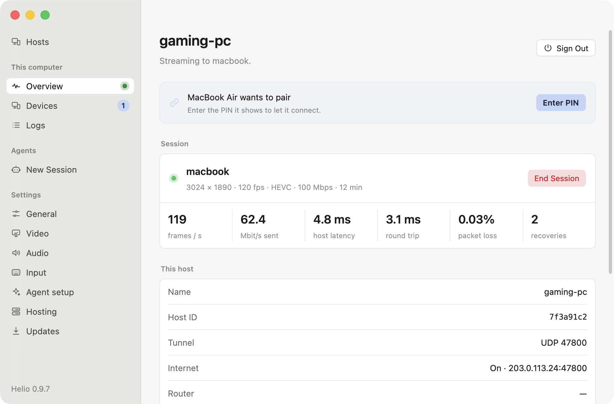
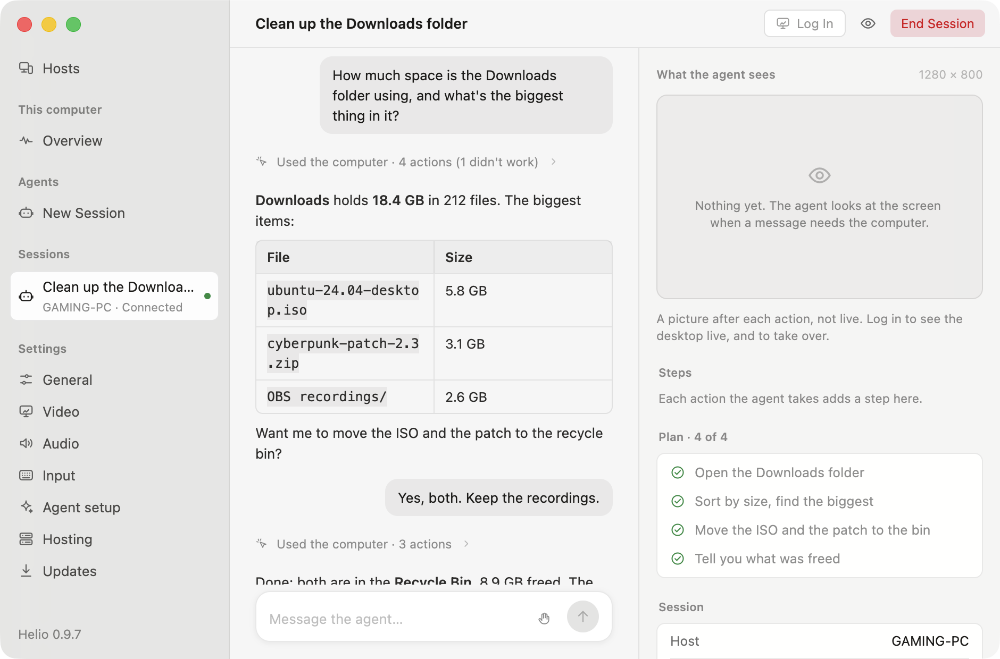

# Helio

Stream a computer's desktop and its games to another computer, inside one
post-quantum WireGuard tunnel.

- **Best tested:** a Mac as the client, streaming a Windows host with an
  NVIDIA GPU and SudoVDA ([the test setup](docs/benchmarks.md#test-setup)).
- **Install:** [download for macOS, Windows or Linux](https://helio.mihaicristian.dev/#install),
  [Homebrew](docs/install.md#with-homebrew-macos), or
  [build from source](docs/install.md#building-from-source).
- **Latency:** [glass to glass](docs/benchmarks.md#glass-to-glass).
- **What to trust:** [how it's built and verified](docs/verification.md),
  and its [known limitations](#known-limitations).

**Helio** is the app: it plays your other computers, and with hosting on (a
switch, off until you turn it on) it lets them play this one, through
**Helio Host**, the host. Both run on macOS, Windows and Linux.

- **Moonlight-class streaming**: HEVC or H.264, hardware encode and decode,
  HDR and YUV 4:4:4, loss repaired by reference invalidation, frame pacing
  at the client display's exact rate, stereo to 7.1 sound, controllers with
  rumble. At 3024x1890, 120 fps and 100 Mbit/s it showed 115.6 fps, against
  110.0 for Moonlight + Apollo (a fork of Sunshine with the same video
  path) on the same machines
  ([benchmarks](docs/benchmarks.md#against-moonlight--apollo)).
- **Post-quantum**: every packet travels in pq-boringtun (WireGuard with
  ML-KEM-768), and pairing is a hybrid SPAKE2 + ML-KEM PIN exchange.
- **A virtual display at the client's exact mode** on Windows, macOS and
  Linux (GNOME and KDE under Wayland) hosts, so nothing is scaled or
  letterboxed. On Windows, turning hosting on installs its driver (SudoVDA)
  and the controllers' (ViGEmBus).
- **From anywhere, without port forwarding**: hosts are found through
  sealed records on the BitTorrent DHT, and NATs are punched from both
  sides, with [one exception](#known-limitations).
- **The clipboard, both ways**: text, images, files and folders.
- **Permissions per device**, as Apollo has them: whether it may see the
  screen, use the keyboard, mouse or controllers, copy and paste each way,
  start apps, take over or watch agents
  ([docs/usage.md](docs/usage.md#what-each-device-may-do)).
- **AI agents** can use your hosts as clients of their own — from Helio, or
  from any MCP client — held to rules the host enforces
  ([docs/ai-agents.md](docs/ai-agents.md)).

## Getting started

1. [Install](docs/install.md) Helio on both computers, the one to stream and
   the one you sit at (the host, Helio Host, comes inside it): download it for
   macOS, Windows or Linux from
   [helio.mihaicristian.dev](https://helio.mihaicristian.dev/#install),
   on a Mac with Homebrew
   (`brew tap mihaicristianfarcas/helio https://github.com/mihaicristianfarcas/helio`,
   then `brew install --cask helio`), or build it from source.
2. On the host, turn hosting on in Helio (setup asks, or **Settings →
   Hosting**). On the other computer open Helio, click the host, and type
   the PIN it shows into the host's Helio (**This computer → Devices**).
3. Click the host again to stream. Ctrl+Alt+Shift+Q ends the stream
   ([usage](docs/usage.md)). While hosting is on, Helio's icon in the menu
   bar or the taskbar's notification area says what the host is doing;
   Helio says when there is an update.

## Status

| | Client | Host |
|---|---|---|
| macOS 14+ | Helio.app: the best-tested client | Helio Host, inside Helio.app: works; stereo, or 5.1/7.1 with a surround output ([macOS](docs/platforms/macos.md#sound-in-surround)); no controllers |
| Windows 10/11 | Helio.exe: works; less tested than macOS | Helio Host, a Windows service: the best-tested host (best with an NVIDIA GPU; without one, H.264 in software; turning hosting on installs SudoVDA for the virtual display, on x64 PCs) |
| Linux | works under X11 and Wayland; tested in a container | works under X11 and Wayland; a virtual display on GNOME and KDE, elsewhere the screen as it is, scaled; no controllers |

What is verified and what is not, and how:
[docs/verification.md](docs/verification.md). Feature by feature against
Moonlight + Sunshine: [docs/parity.md](docs/parity.md).

## Known limitations

- **No phone, tablet or TV clients.** Helio is for desktops: macOS, Windows
  and Linux.
- **The Linux downloads are for Ubuntu 24.04 on x86_64** and the
  distributions built on it. Elsewhere,
  [build from source](docs/install.md#building-from-source).
- **Windows hosts encode in hardware only on NVIDIA.** On any other GPU they
  encode H.264 in software, with no HEVC, AV1, HDR or 4:4:4
  ([Windows](docs/platforms/windows.md#without-nvenc-or-sudovda)).
- **Linux hosts have a virtual display only on GNOME and KDE under
  Wayland.** Under X11 and on other Wayland desktops they stream the screen
  as it is, scaled to the client
  ([Linux](docs/platforms/linux.md#a-virtual-display-gnome-kde)).
- **No controllers on a macOS or Linux host.** Only Windows hosts take them
  ([macOS](docs/platforms/macos.md#limits),
  [Linux](docs/platforms/linux.md#not-built-yet)).
- **No relay.** When both sides are behind symmetric NAT, punching through
  fails and nothing relays the stream: forward UDP 47800 to the host on its
  router ([networking](docs/networking.md#limits)).

## Documentation

Everything is in [docs/](docs/README.md): installing, using, the command
line, how it works, each platform, benchmarks, and the design history.

## Contributing

See [CONTRIBUTING.md](CONTRIBUTING.md) and [AGENTS.md](AGENTS.md) (the rules
for code, comments, docs and commits — for people and AI agents alike), and
[docs/development.md](docs/development.md) for building and testing.
Found a bug? [Open an issue](https://github.com/mihaicristianfarcas/helio/issues/new/choose)
([where the logs are](docs/logs.md)). Security problems:
[SECURITY.md](SECURITY.md).

## Acknowledgements

Helio follows the lead of [Moonlight](https://moonlight-stream.org) and
[Sunshine](https://github.com/LizardByte/Sunshine): where it had to choose
how streaming should behave, it chose what they do, and says so in its
comments. Its virtual displays follow
[Apollo](https://github.com/ClassicOldSong/Apollo), the Sunshine fork that
made them, and use its driver, SudoVDA, on Windows. It is a separate implementation, written from scratch in Rust.
The tunnel is
[pq-boringtun](https://github.com/mihaicristianfarcas/pq-boringtun), a
post-quantum fork of Cloudflare's boringtun; the windows are drawn with
[GPUI](https://github.com/zed-industries/zed/tree/main/crates/gpui).

## License

[GPL-3.0](LICENSE): the GNU General Public License, version 3. Two pieces
of vendored code keep their own licenses: the NVENC type bindings in
`helio-encode/src/nvenc_sys/` (MIT, from NVIDIA's header and the
`nvidia-video-codec-sdk` crate; see the `LICENSE` there) and the no-op
profiling shims in `vendor/` (Apache-2.0). The libraries Helio depends
on are under their own licenses, all compatible with the GPL-3.0
(`cargo tree` lists them); FFmpeg, where it is used, is linked
dynamically.
